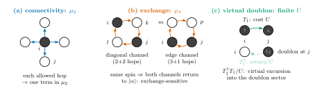

# Hubbard spectral moments

Code, checks, run records and a Lean 4 formalization for the paper *Spectral Moments of the
Projected Hubbard Configuration Graph* (D. Souza, 2026; preprint, the arXiv link will be
added here).

The paper studies few fermions in the strongly repulsive Hubbard model through the moments
of the no-double-occupancy hopping operator $H_\infty=P_0H_tP_0$, starting from the
two-electron problem of D. Souza and F. Claro (2010), whose figures the first scripts here
reproduce.

<p align="center">
  <picture>
    <source media="(prefers-color-scheme: dark)" srcset="docs/figures/hierarchy-dark.svg">
    
  </picture>
</p>

**The moment hierarchy** (the paper's Fig. 6). (a) $\mu_2$ counts single allowed hops of a
particle to an empty neighbor: a spin-blind connectivity count. (b) $\mu_4$ is the first
moment to see exchange: two four-hop closed paths, a diagonal and an edge channel, return the
occupied sites $\{i,j\}$ to themselves, and restore the initial state only when $i$ and $j$
carry the same spin. (c) At finite $U$, a hop onto an opposite-spin neighbor creates a
virtual doublon at energy cost $U$; with the return hop it corrects $\mu_2$ only at order
$U^{-2}$.

## The results in brief

1. **Second moment, exactly.** For $n$ fermions on any finite graph with $N$ sites and any
   spin-independent Hermitian hopping, $\mu_2=\frac{n(N-n)}{N(N-1)}\sum_{i\ne j}|t_{ij}|^2$,
   whatever the spin composition (machine-checked).
2. **Exchange in the fourth moment.** On any finite graph $\mu_4(U\to\infty)$ is exactly
   affine in the same-spin pair count, because four hops can only produce the identity, a
   transposition or a 3-cycle (machine-checked). For uniform hopping the slope is
   $\alpha(N,n)=-8C_4(N-n)(8N-11n-2)/[N(N-1)(N-2)(N-3)]$, fixed by the number $C_4$ of
   4-cycles.
3. **Finite $U$.** The $1/U$ term of the band variance vanishes on every triangle-free graph
   (the cross term is machine-checked). The $U^{-2}$ coefficient is an exact trace; its sign
   and its near-proportionality to $N_\uparrow N_\downarrow$ at low filling are numerical.
4. **Flux.** For two particles, the exchange slope responds as $\cos\Phi_\square$, an ordinary
   charge-$e$ harmonic; the Schrieffer–Wolff doublon hopping carries the doubled phase
   $t_de^{2iA_{ij}}$ (its second-order terms machine-checked for two electrons), compared without fitted
   parameters with the exact flux-threaded two-electron U-band.

The precise statements, conventions and evidence tier of each claim are in
[`STATEMENT.md`](STATEMENT.md).

## What is not claimed

Nothing here concerns many-pair phase stiffness, off-diagonal long-range order,
condensation, collective transport or superconductivity. Repulsive binding and the pair's
charge $2e$ are known; neither the no-double-occupancy projection, nor the moment method,
nor the functional form of the doublon Hamiltonian is claimed as new. The full list is in
[`STATEMENT.md`](STATEMENT.md) and the paper's Discussion; [`docs/faq.md`](docs/faq.md)
answers the common questions.

## How the claims were checked

Every claim carries one evidence tier: machine-checked in Lean (`lean/`), analytic proof
(the paper's Supplemental Material), exact numerics, numerical evidence, or literature.
`checks/run_checks.py` recomputes every checked number of the paper in about two minutes;
`evidence/` holds dated records of the longer runs and of the Lean checks (six independent
kernels, negative controls, `lake check`). [`docs/method.md`](docs/method.md) says what each
check does and does not establish, and [`docs/correspondence.tsv`](docs/correspondence.tsv)
maps every numbered result of the paper to its evidence.

| document | contents |
|---|---|
| [`STATEMENT.md`](STATEMENT.md) | the claims, conventions, non-claims and tiers |
| [`docs/method.md`](docs/method.md) | how the evidence was produced; what each check establishes |
| [`docs/framework.md`](docs/framework.md) | the rules the work follows |
| [`docs/provenance.md`](docs/provenance.md) | what comes from earlier work, what is new, the tools used |
| [`docs/glossary.md`](docs/glossary.md) | code and Lean names against the paper's symbols |
| [`docs/faq.md`](docs/faq.md) | questions about the result and its limits |
| [`CHANGELOG.md`](CHANGELOG.md) | releases and corrections |

## Environment

The code is plain Python 3 with numpy, scipy and matplotlib, pinned in
`requirements.txt`. It was developed with Python 3.13. Most scripts need
well under 1 GB of memory. The largest dense diagonalizations need about
6.5 GB.

I manage virtual environments with
[virtualenvwrapper](https://virtualenvwrapper.readthedocs.io/), and the
environment for this project is called `hubbard`.

**One-time setup**

```sh
# virtualenvwrapper itself, once per machine (here via Homebrew)
brew install virtualenvwrapper
echo 'source virtualenvwrapper.sh' >> ~/.bashrc   # or ~/.zshrc; environments live in ~/.virtualenvs

# the project environment
mkvirtualenv -p python3.13 hubbard
pip install -r requirements.txt
```

**Every session**

```sh
workon hubbard
cd path/to/hubbard-spectral-moments
```

If you don't use virtualenvwrapper, a plain virtual environment works the
same way (`.venv/` is git-ignored):

```sh
python3 -m venv .venv
source .venv/bin/activate
pip install -r requirements.txt
```

## Reproducing the results

Run every script **from the repository root**. Outputs go to `results/`,
which is not tracked in git (only `results/.gitkeep` is tracked), so the
figures and data files are always regenerated, never committed.

```sh
python dos_fig1.py        # writes results/fig1_dos_reproduction.png, results/eigenvalues_U*.dat
```

The scripts are independent except for one ordering constraint:
`analytical_dos.py` reads the eigenvalues written by `dos_fig1.py` and
`uband_shiftinvert.py`, so run those two first.

The times below are wall-clock times on an Apple M3 (8 cores, 24 GB RAM,
numpy linked against Apple Accelerate), measured with a full run of every
script in the order listed. Peak memory is the process's maximum resident
set size.

### 1. Reproducing Souza & Claro (2010)

| Script | What it computes | Output in `results/` | Time | Peak memory |
|---|---|---|---|---|
| `dos_fig1.py` | Fig. 1 of the 2010 paper: two-electron DOS on a 7×7 lattice, U = 0, 10, 15, 20 | `fig1_dos_reproduction.png`, `eigenvalues_U{0,10,15,20}.dat` | 4 s | 0.3 GB |
| `centroid_fig3.py` | Fig. 3 of the 2010 paper: centroid oscillation of the pair under a field (Crank–Nicolson) and its power spectrum | `fig3_centroid_reproduction.png`, `position_U*.dat`, `spectrum_U*.dat` | 7.5 min | 0.3 GB |
| `energy_distance.py` | Energy-resolved mean particle separation: extended band vs. bound U-band | `energy_distance_U{0,10,15,20,50}.png` | 5 s | 0.5 GB |
| `uband_shiftinvert.py` | U-band eigenvalues at L = 9, 11, 13 by shift-invert sparse diagonalization | `uband_L{9,11,13}_U{10,15,20}.dat` | 12 min | 3.0 GB |
| `analytical_dos.py` | Exact hypercubic DOS for d = 1…8, compared with the two-electron spectra (**run after the two scripts above**) | `analytical_dos_1234D.png`, `analytical_dos_5678D.png`, `compare_U0_vs_4D.png`, `compare_Uband_vs_2D.png` | 1.7 min | 1.4 GB |

### 2. Manuscript figures

| Script | Manuscript | Output in `results/` | Time | Peak memory |
|---|---|---|---|---|
| `tbc_dos.py` | Figs. 1, 2, 9 | `tbc_compare_U0_vs_4D.png`, `kgrid_collapse_universal.png`, `kgrid_compare_Uband_vs_2D.png` | 1.5 min | 0.2 GB |
| `fig_sectors.py` | Fig. 3 (sector structure, full spectra) | `fig_sectors.png` | 30 min | 8 GB |
| `fig_fpc_Lscaling.py` | Fig. 4 (finite-population correction, L = 3…10) | `fpc_Lscaling.png` | 1 s | 0.1 GB |
| `fig_naive_vs_fpc.py` | Fig. 5 (naive vs. FPC vs. full projection) | `naive_vs_fpc_vs_exact.png` | 2 s | 0.1 GB |
| `fig_dos_gaussian_collapse.py` | Fig. 7 (Appendix A, Gaussian collapse of the hypercubic DOS) | `dos_gaussian_collapse.png` | 14 s | 0.1 GB |
| `mu4_flux_validation.py` | Fig. 10 (Appendix E, μ₄ under uniform flux) | `mu4_flux_response.png` | 11 s | 0.1 GB |
| `doublon_flux_validation.py` | Fig. 11 (Appendix E, doublon flux response: charge-2e check) | `doublon_flux_response.png` | 27 s | 0.2 GB |

Figs. 6 and 8 are schematics drawn directly in LaTeX and have no script. The figure at the
top of this README is Fig. 6 redrawn; its source and build commands are in
[`docs/figures/hierarchy.tex`](docs/figures/hierarchy.tex).

### 3. Checks that print to the terminal

These write no files. They print the numbers the manuscript quotes.

| Script | What it prints | Time | Peak memory |
|---|---|---|---|
| `sw_correction.py` | Schrieffer–Wolff 1/U² coefficient c2 = Var(V) + 2⟨T0 H3⟩ (third order included) and its second-order part Var(V), for (3,1), (2,2), (4,0) at L = 4 and (3,1), (2,2) at L = 5 (finite-U table; for its n = 2, 3 rows see section 4) | 10 s | 0.3 GB |
| `verify_sectors_provenance.py` | Exact sector state counts and sector mean energies behind Fig. 3, from full dense diagonalization | 25 min | 5.7 GB |
| `fig3_center_diagnostic.py` | Whether the shift of the sector centers scales as λ²/U or λ³/U² | 59 min | 6.3 GB |

### 4. Tables computed directly from the modules

The μ₂(U → ∞) and μ₄(U → ∞) tables come from the sparse-trace module,
without diagonalization. Each (up, down) pair is a spin composition. This
prints them as exact fractions in a few seconds:

```sh
python - <<'EOF'
from fractions import Fraction
from uinf_traces_sparse import build_Uinf_H_sparse, moments_via_traces
for L, up, down in [(3, 1, 1), (4, 2, 0), (4, 1, 1), (4, 3, 0), (4, 2, 1), (4, 4, 0), (4, 3, 1), (4, 2, 2)]:
    H, D = build_Uinf_H_sparse(L, up, down)
    mu2, mu4 = moments_via_traces(H, D)
    print(f"L={L} ({up},{down})  D0={D:6d}  mu2={Fraction(mu2).limit_denominator(1000)}  "
          f"mu4={Fraction(mu4).limit_denominator(1000)}")
EOF
```

The n = 2 and n = 3 rows of the finite-U table, (1,1), (3,0) and (2,1) at L = 4, are not
printed by `sw_correction.py`. They come from the same function:

```sh
python - <<'EOF'
from sw_correction import sw_moments
for up, down in [(1, 1), (3, 0), (2, 1)]:
    m = sw_moments(4, up, down, lam=1.0, third_order=True)
    D0 = m["D0"]
    var_v = m["tr_Vsq"]/D0 - (m["tr_V"]/D0)**2
    print((up, down), f"Var(V) = {var_v:.6f}  c2 = {var_v + 2*m['tr_T0H3']/D0:.6f}")
EOF
```

### Run everything

```sh
workon hubbard
for s in dos_fig1 centroid_fig3 energy_distance uband_shiftinvert analytical_dos \
         tbc_dos fig_sectors fig_fpc_Lscaling fig_naive_vs_fpc fig_dos_gaussian_collapse \
         mu4_flux_validation doublon_flux_validation \
         sw_correction verify_sectors_provenance fig3_center_diagnostic; do
    echo "== $s"; python "$s.py" || break
done
```

The full run takes just under 2 hours on the machine above. The two
dense-diagonalization checks (`verify_sectors_provenance.py` and
`fig3_center_diagnostic.py`) account for about 85 minutes of that, so all
the figures alone take about 30 minutes.

## Checks and the Lean formalization

```sh
python checks/run_checks.py                 # every checked number of the paper, about 2 minutes
python checks/lean_linux_run.py --record    # Linux only, about 45 minutes; see lean/README.md
```

[`checks/README.md`](checks/README.md) lists what each check compares and the slow runs
behind `evidence/`; [`lean/README.md`](lean/README.md) explains the build, the axiom audit,
`lake comparator` and `lake check`, and what each formal statement does and does not cover.

## Manuscript

The paper and its Supplemental Material are on arXiv; their sources are not in this
repository. `manuscript/` is kept as an empty folder: `paper.tex` loads its figures from
`../results/`, so generate them first (section 2). The references live in
`manuscript/references.bib` and are formatted with the APS style
`apsrev4-2` (part of REVTeX, included in TeX Live), so BibTeX runs between
the LaTeX passes:

```sh
cd manuscript
pdflatex paper.tex
bibtex paper
pdflatex paper.tex
pdflatex paper.tex
```

## Shared modules

These are imported by the scripts above rather than run directly. Running
one only prints `module loaded`.

| Module | Contents |
|---|---|
| `plotstyle.py` | Shared figure style: Okabe–Ito colorblind-safe palette, one color family per concept (connectivity μ₂, exchange μ₄, doublons) |
| `three_electron.py` | n = 3 (2↑ + 1↓) basis and Hamiltonian; lattice neighbors and antisymmetrized pair hopping reused everywhere |
| `four_electron.py` | n = 4 (2↑ + 2↓) Hamiltonian and doublon-occupation operator |
| `four_electron_31.py` | n = 4 (3↑ + 1↓) Hamiltonian |
| `sector_theory.py` | Antisymmetrized k-fermion hopping and theoretical moments of sums of cosine dispersions |
| `uinf_traces_sparse.py` | Sparse H∞ = P₀HₜP₀ and μ₂, μ₄ from traces |
| `uinf_traces.py` | Dense H∞ for small systems (not used by the scripts above) |
| `doublon_doublon.py`, `doublon_tmatrix.py` | Two-doublon problem in a finite box and on the infinite lattice (T-matrix); exploratory, not used by the scripts above |

## Citing and license

Please cite the paper, and this repository through its Zenodo record (see
[`CITATION.cff`](CITATION.cff); GitHub's "Cite this repository" uses it). Code and Lean
formalization: Apache-2.0 ([`LICENSE`](LICENSE)).

## Reference

D. Souza and F. Claro, "Paired states of interacting electrons in a two
dimensional lattice", Phys. Rev. B **82**, 205437 (2010),
[arXiv:1005.1857](https://arxiv.org/abs/1005.1857).
